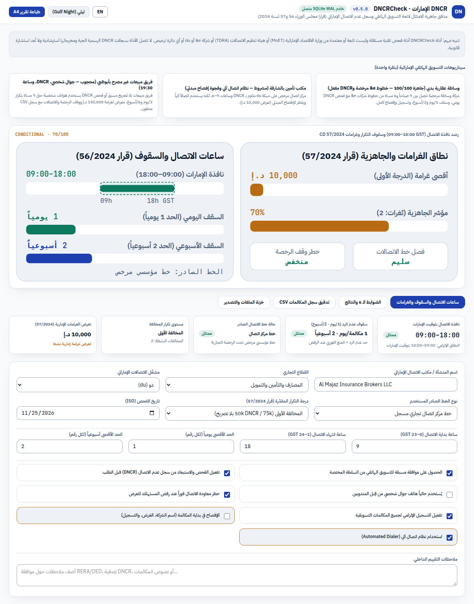
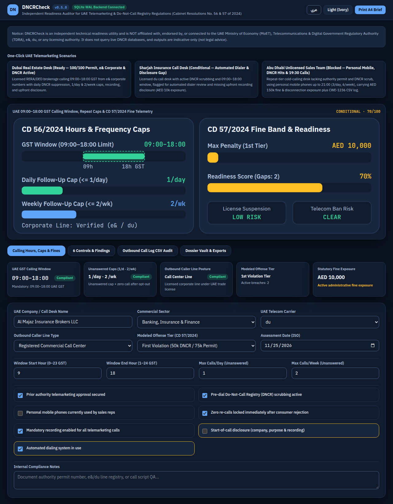
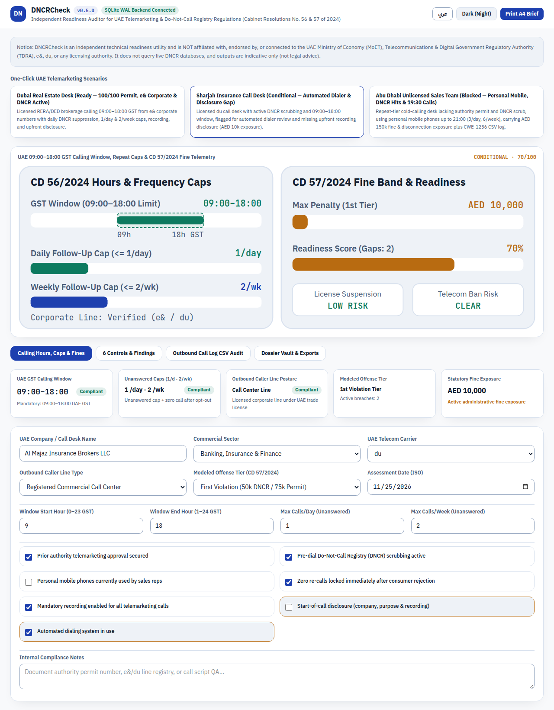
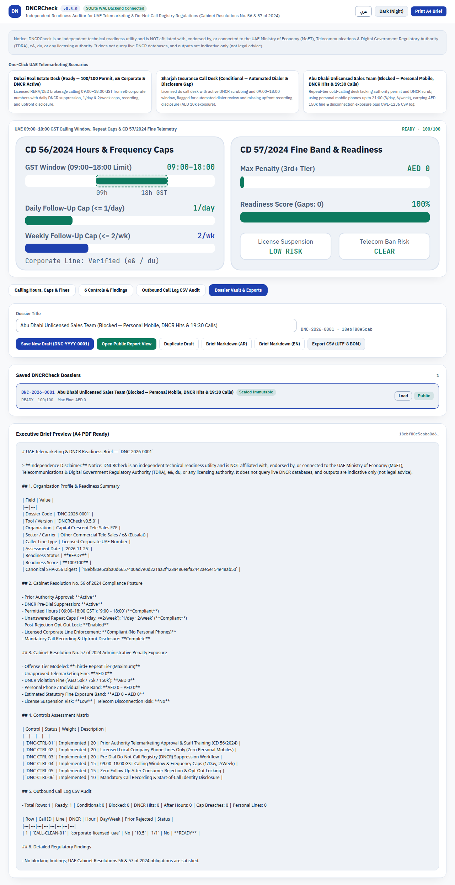
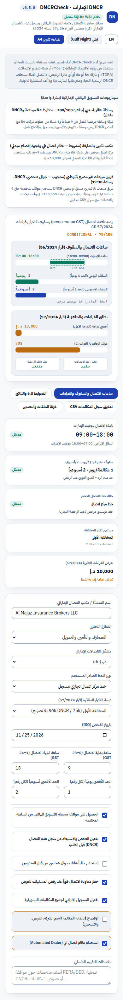
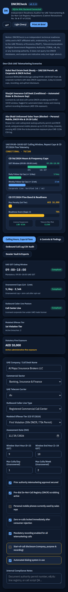

# DNCRCheck — UAE Telemarketing & Do-Not-Call Registry (`DNCR`) Compliance Studio

[](LICENSE)

> **Bilingual (`AR RTL` `Telecom Ivory` Light & `EN LTR` `Gulf Night` Dark) · Dual-Mode (`Node 22 + SQLite WAL` or `$0` Browser Static Mode)**

Zero-runtime-backend-dependency readiness auditor, `node:sqlite WAL` REST API server, and bilingual **Arabic (`RTL`) / English (`LTR`)** web application modeled on the United Arab Emirates telemarketing regulatory framework *(effective `2024-08-27`)*:

- **Cabinet Resolution No. (56) of 2024** *(Regulating Marketing Through Telephone Calls)*:
  - Enforces **prior regulatory authority approval** before outbound marketing campaigns.
  - Restricts outbound telemarketing calls to **`09:00–18:00` UAE GST (`Asia/Dubai`)**.
  - Enforces unanswered frequency caps of **`<= 1 call/day`** and **`<= 2 calls/week`**, plus immediate suppression after consumer rejection.
  - Requires **licensed local corporate UAE lines (`e&` / `du`)** registered under the company's trade license and prohibits personal mobile phones or unregistered VoIP lines.
  - Requires **mandatory call recording** and **upfront start-of-call disclosure** (company name, marketing purpose, recording notice).
- **Cabinet Resolution No. (57) of 2024** *(Administrative Violations & Penalties)*:
  - Models escalated DNCR calling penalties (**`AED 50,000` -> `75,000` -> `150,000`**), unapproved telemarketing fines (**`AED 75,000` -> `100,000` -> `150,000`**), individual personal-line fines (**`AED 5,000` – `50,000`** + telecom disconnection risk), and operational/automated-dialer breaches (**`AED 10,000+`**), plus commercial license suspension risk on repeat violations.
- **Batch Outbound Call-Log CSV Auditor**:
  - Audits call log batches against calling hours, DNCR hits, `1/day` & `2/week` caps, opt-out follow-ups, and personal lines, with **`CWE-1236` formula injection neutralization**, **`UTF-8 BOM` (`EF BB BF`)** export, and canonical `SHA-256` digests.

> **Independence & Legal Disclaimer**: DNCRCheck is an independent technical readiness utility and is **NOT affiliated with, endorsed by, or connected to** the UAE Ministry of Economy (`MoET`), Telecommunications & Digital Government Regulatory Authority (`TDRA`), `e&` (Etisalat), `du`, or any UAE licensing authority. It does not query live DNCR databases, and all outputs are indicative only (not legal advice).

---

## Visual Showcase (`AR RTL` & `EN LTR`)

### Desktop Arabic RTL (`Telecom Ivory` Light — Sharjah Insurance `70/100`)


### Desktop English LTR (`Gulf Night` Dark)


### Sharjah Conditional Posture (`Automated Dialer & Disclosure Gap — AED 10,000`)


### Remediated Desk & Sealed `DNC-2026-0001` Dossier (`SHA-256`)


### Mobile Arabic RTL View (`Telecom Ivory`, `390x844`)


### Mobile English LTR View (`Gulf Night`, `390x844`)


---

## Quick Start (Local)

```bash
npm install
npm run typecheck
npm test
npm run build
npm start
# Opens HTTP + node:sqlite WAL backend on http://127.0.0.1:4231/dncrcheck
```

Run headless Chrome Playwright end-to-end tests:

```bash
npm run test:e2e
```

## `$0` Static Deploy (Cloudflare Workers Assets)

```bash
npm run build
npx wrangler deploy
```

When served without the Node backend, the UI automatically operates in **`$0` Browser Mode**, keeping all engines (`src/core/*`), SHA-256 sealing, Markdown briefs, and BOM CSV exports functional via `localStorage`. See [launch/DEPLOY-AND-SHARE.md](launch/DEPLOY-AND-SHARE.md) for Docker, Cloudflare, and systemd guides.

## Self-Hosted Docker / SQLite WAL Deploy

```bash
docker compose up -d --build
# Runs Node 22 built-in HTTP + SQLite WAL persistence on 127.0.0.1:4231
```

## Key API Endpoints (Node 22 Built-In Server)

| Method & Route | Description |
|---|---|
| `GET /health`, `GET /readyz` | Liveness & SQLite WAL readiness probes (exempt from rate limits) |
| `GET /api/presets` | Three realistic UAE 2026 telemarketing scenarios (Dubai Brokerage, Sharjah Insurance, Abu Dhabi Unlicensed) |
| `POST /api/calling-rules` | Evaluate `09:00–18:00 GST`, `1/day` & `2/week`, licensed line, recording & disclosure rules |
| `POST /api/penalties` | Cabinet Resolution `57/2024` fine tier & license/telecom risk estimator (`AED 5k–150k`) |
| `POST /api/audit-csv` | Outbound call log CSV auditor (`CWE-1236` safe + `UTF-8 BOM`) |
| `POST /api/assess` | Full readiness assessment with 6 weighted controls & canonical `SHA-256` digest |
| `GET/POST /api/dossiers` | Persistent `node:sqlite WAL` dossier vault (`DNC-YYYY-0001` atomic codes) |
| `POST /api/dossiers/:code/finalize` | Cryptographically seal dossier & generate shareable public slug |
| `GET /api/dossiers/:code/brief.md` | Download bilingual (`?lang=ar` or `en`) Markdown compliance brief |
| `GET /api/dossiers/:code/export.csv` | Download `UTF-8 BOM` CSV audit report (`CWE-1236` sanitized) |
| `GET /api/public/reports/:slugOrCode` | Public read-only sealed report JSON with persistent view counter |

## License

MIT
